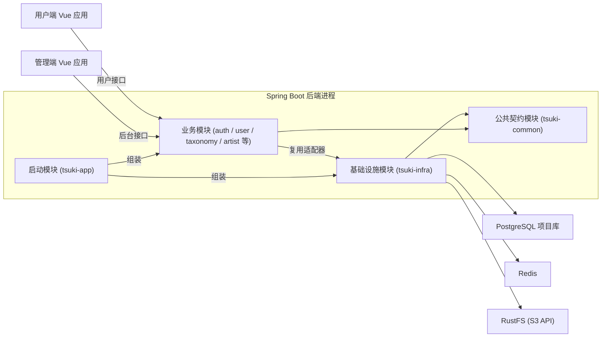

# Tsuki 项目概览

Tsuki 是一个由个人独立开发和长期维护的在线音乐网站，参考网易云音乐的曲库浏览和听歌体验，站内托管有授权的音乐。先建设管理端，使曲库能够日常维护，再基于管理端发布的数据开发用户端。功能范围随实际需求演进，工程取舍兼顾可维护性和可演示性。

## 应用组织

后端按职责与业务拆分 Maven 子模块，由 `tsuki-app` 启动模块组装为一个进程，使用一个 PostgreSQL 数据库：

- `tsuki-app`：负责应用启动、模块组装、Flyway 数据库迁移，以及数据源、Redis、MyBatis-Plus 和对象存储等运行参数配置。
- `tsuki-infra`：集中管理 PostgreSQL 驱动、MyBatis-Plus 装配（分页拦截器、UTC 自动填充与公共分页适配器 `MybatisPageAdapter`）、Redis 自动装配以及 RustFS（`S3Client`）客户端配置；供启动模块装配及需要持久化或中间件能力的业务模块复用。
- `tsuki-common`：仅提供统一响应、公共异常处理、Web 参数校验、国家/地区代码校验及通用字符串工具和解耦后的公共分页类型（`PageQuery`、`PageResult`），不依赖具体持久化或中间件框架。
- 业务模块（如认证、用户、分类与标签、艺人等）：各自负责自己的 HTTP 接口、业务规则、实体与 Mapper 数据访问，并在 POM 中显式声明直接使用的依赖。跨模块调用通过公开接口进行，构建依赖可直接审查。 [Maven 多模块指南](https://maven.apache.org/guides/mini/guide-multiple-modules.html) · [Spring 应用模块约定](https://docs.spring.io/spring-modulith/reference/fundamentals.html)

两个前端应用共用一个 pnpm workspace，各自构建，按自身业务组织页面、组件和请求逻辑；跨端复用的无框架 HTTP 客户端、响应解包、401 单飞刷新与认证契约抽离在 `packages/api-client` 中，跨端共享常量与安全跳转等基础工具放在 `packages/shared` 中（显式子路径导出）。管理端（`apps/admin`）采用 `app -> features -> shared` 单向依赖的 Feature-based 分层：应用壳子、导航汇总（各 feature 通过 `menu.ts` 显式声明菜单项并配合 `RouteMeta.activeMenu` 处理子页高亮）与 `403`/`404` 异常页集中在 `app/`，业务模块按 `features/<domain>/` 组织，管理端的数据维护界面与用户端的播放界面保持独立演进，共用 workspace 管理工具链和锁文件。 [pnpm Workspace](https://pnpm.io/workspaces/)

## 技术选型

| 技术 | 职责与选型依据 |
| --- | --- |
| Java 21、Spring Boot 4.1.2、Maven | 采用 Java 21 作为运行基线，使用 Spring Boot 的 Web 和依赖管理能力。Maven 管理构建、模块聚合与显式依赖。 [Spring Boot 系统要求](https://docs.spring.io/spring-boot/system-requirements.html) · [Maven 多模块指南](https://maven.apache.org/guides/mini/guide-multiple-modules.html) |
| PostgreSQL、Flyway、MyBatis-Plus | PostgreSQL 保存业务记录，Flyway 统一执行版本化数据库迁移。MyBatis-Plus 使用 Boot 4 专用 starter，复用通用持久化操作，同时保留按业务需要编写 SQL 的能力。 [Flyway 接入](https://docs.spring.io/spring-boot/4.1/how-to/data-initialization.html) · [MyBatis-Plus 安装](https://baomidou.com/en/getting-started/install/) |
| RustFS、S3 SDK | RustFS 保存音频和封面等文件，数据库保存对象键和业务关联。通过标准 S3 SDK 调用对象存储。 [RustFS S3 兼容矩阵](https://docs.rustfs.com/en/reference/s3-compatibility) |
| Vue 3、TypeScript、Vite、Vue Router | Vue 负责界面，TypeScript 为组件和接口数据提供类型检查，Vite 负责开发与构建，Vue Router 管理应用内路由。 [Vue 官方脚手架](https://vuejs.org/guide/quick-start.html) |
| Naive UI、Tailwind CSS | Naive UI 是整个前端项目（管理端与用户端）的核心组件库，交互组件、排版与反馈优先使用 Naive UI 并复用各端统一的主题配置与 `NGlobalStyle`；Tailwind CSS 负责外层页面容器定位与局部间距。 [Naive UI](https://github.com/tusen-ai/naive-ui) · [Tailwind CSS](https://tailwindcss.com/docs/installation/using-vite) |
| TanStack Query、Pinia、VueUse | TanStack Query 管理服务端数据的获取、缓存和刷新；Pinia 管理需要跨页面共享的客户端状态；通用浏览器持久化与响应式能力优先复用 `@vueuse/core`，不重复造轮子。 [TanStack Vue Query](https://tanstack.com/query/latest/docs/framework/vue/overview) · [Pinia](https://pinia.vuejs.org/introduction.html) · [VueUse](https://vueuse.org/) |

## 中间件使用约定

Redis、RabbitMQ、Elasticsearch 均为必用技术，接入随业务模块推进。每次接入设计应明确组件承担的业务职责、数据权威来源，以及如何通过实际操作演示其作用。主动设计与利用已定的技术栈，充分利用，不要让技术选型成为空壳。

本地共享服务的接入方式见[本地工程指南](05-engineering-guide.md)。
