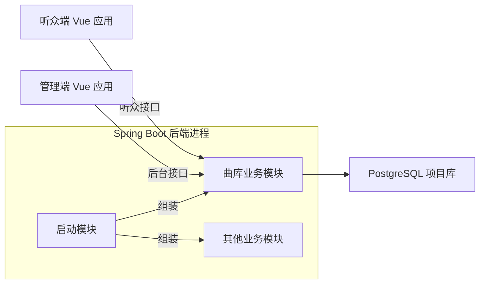

# Tsuki 项目概览

Tsuki 是一个由个人独立开发和长期维护的在线音乐网站，参考网易云音乐的曲库浏览和听歌体验，站内托管有授权的音乐。先建设管理端，使曲库能够日常维护，再基于管理端发布的数据开发听众端。功能范围随实际需求演进，工程取舍兼顾可维护性和可演示性。

## 应用组织

后端按业务拆分 Maven 子模块，由一个 Spring Boot 启动模块组装为一个进程，使用一个 PostgreSQL 数据库。每个业务模块负责自己的 HTTP 接口、业务规则和数据访问。以曲库为例，管理端编辑入口与听众端读取入口同属曲库模块，各自声明访问权限。跨模块调用依赖对方的公开接口，并在调用方 POM 中声明依赖。这样的组织让同一业务的改动集中，构建依赖也能直接审查。 [Maven 多模块指南](https://maven.apache.org/guides/mini/guide-multiple-modules.html) · [Spring 应用模块约定](https://docs.spring.io/spring-modulith/reference/fundamentals.html)

两个前端应用共用一个 pnpm workspace，各自构建，按自身业务组织页面、组件和请求逻辑。管理端的数据维护界面与听众端的播放界面可以独立演进，共用 workspace 管理工具链和锁文件。 [pnpm Workspace](https://pnpm.io/workspaces/)

## 技术选型

| 技术 | 职责与选型依据 |
| --- | --- |
| Java 21、Spring Boot 4.1.2、Maven | 采用 Java 21 作为运行基线，使用 Spring Boot 的 Web 和依赖管理能力。Maven 管理构建、模块聚合与显式依赖。 [Spring Boot 系统要求](https://docs.spring.io/spring-boot/system-requirements.html) · [Maven 多模块指南](https://maven.apache.org/guides/mini/guide-multiple-modules.html) |
| PostgreSQL、Flyway、MyBatis-Plus | PostgreSQL 保存业务记录，Flyway 统一执行版本化数据库迁移。MyBatis-Plus 使用 Boot 4 专用 starter，复用通用持久化操作，同时保留按业务需要编写 SQL 的能力。 [Flyway 接入](https://docs.spring.io/spring-boot/4.1/how-to/data-initialization.html) · [MyBatis-Plus 安装](https://baomidou.com/en/getting-started/install/) |
| RustFS、S3 SDK | RustFS 保存音频和封面等文件，数据库保存对象键和业务关联。通过标准 S3 SDK 调用对象存储。 [RustFS S3 兼容矩阵](https://docs.rustfs.com/en/reference/s3-compatibility) |
| Vue 3、TypeScript、Vite、Vue Router | Vue 负责界面，TypeScript 为组件和接口数据提供类型检查，Vite 负责开发与构建，Vue Router 管理应用内路由。 [Vue 官方脚手架](https://vuejs.org/guide/quick-start.html) |
| Naive UI、Tailwind CSS | 管理端表格和表单使用 Naive UI，复用组件行为与主题配置。Tailwind CSS 负责页面布局和间距。 [Naive UI](https://github.com/tusen-ai/naive-ui) · [Tailwind CSS](https://tailwindcss.com/docs/installation/using-vite) |
| TanStack Query、Pinia | TanStack Query 管理服务端数据的获取、缓存和刷新。Pinia 管理需要跨页面共享的客户端状态。 [TanStack Vue Query](https://tanstack.com/query/latest/docs/framework/vue/overview) · [Pinia](https://pinia.vuejs.org/introduction.html) |

## 中间件使用约定

Redis、RabbitMQ、Elasticsearch 均为必用技术，接入随业务模块推进。每次接入设计应明确组件承担的业务职责、数据权威来源，以及如何通过实际操作演示其作用。

- **Redis** 的具体用途与登录方案在认证模块设计时确定。
- **RabbitMQ** 用于有实际需求的异步任务，具体任务及其结果回写随对应业务流程确定。
- **Elasticsearch** 提供曲库搜索。PostgreSQL 保存曲库权威数据，搜索索引从曲库数据派生。接入时明确内容更新、下架和索引重建的处理方式。

本地共享服务的接入方式见[本地工程指南](05-engineering-guide.md)。
