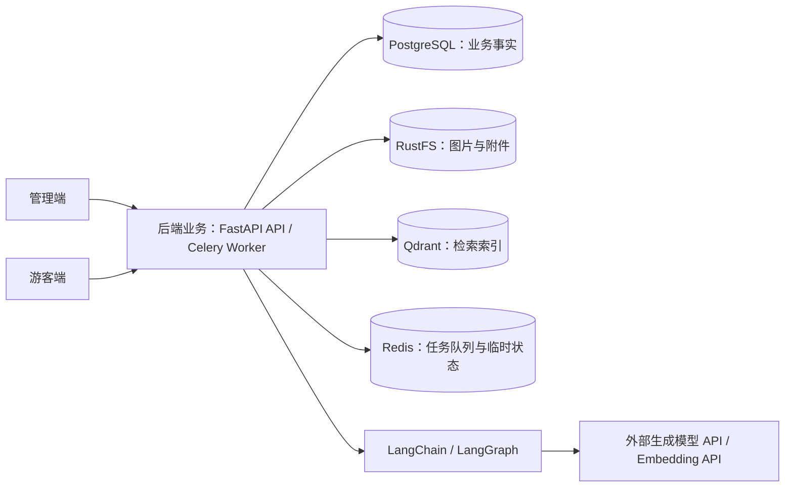

# 项目概览

## 项目定位

Tsuki 是个人独立开发和维护的二次元 Wiki 网站，面向一般用户提供匿名浏览、检索和基于站内内容的 AI 问答。

内容由结构化条目、条目之间的关联关系及富文本正文组成。管理端承担数据维护和 AI 辅助录入审核，游客端承担公开内容的展示与访问。开发顺序为先建设数据维护能力，再开发游客端；这一顺序不缩减已确认的产品需求。

## 技术基线与职责

下表为已确认的技术选型与组件职责，不代表所有组件均已接入。后端依赖范围以 `backend/pyproject.toml` 为准，解析版本由 `backend/uv.lock` 记录。

| 领域 | 技术 | 职责与边界 |
| --- | --- | --- |
| Python 运行时 | Python 3.12 | 后端与 Worker 的运行时 |
| Python 工程管理 | uv | Python 版本、虚拟环境、依赖和锁文件管理 |
| Python 代码质量与格式化 | Ruff | 统一静态检查、导入排序与格式化，检查规则按项目需要显式启用 |
| 后端框架 | FastAPI | 对外提供业务 API，通过依赖机制组织公共能力 |
| 数据校验 | Pydantic | 定义与校验请求、响应模型；与数据库模型分开维护 |
| 配置管理 | pydantic-settings | 从配置来源读取和校验应用设置 |
| 数据访问 | SQLAlchemy 2.x asyncio、psycopg 3 | 异步数据库映射、查询与事务处理 |
| 数据库迁移 | Alembic | 管理数据库结构变更 |
| 主数据库 | PostgreSQL | 保存条目、条目关系、正文、文件元数据及业务状态，作为业务事实来源 |
| 对象存储 | RustFS、S3 SDK | 自建图片与附件存储，通过 S3 接口访问；文件元数据仍由 PostgreSQL 管理 |
| 模型与检索接入 | LangChain | 接入外部模型 API 和检索组件 |
| AI 流程编排 | LangGraph | 编排有状态、需要人工审核的 AI 流程，不接管普通 CRUD |
| 向量检索 | Qdrant | 保存从正式内容生成的可重建检索索引，不作为业务事实来源 |
| 后台任务执行 | Celery | 在独立 Worker 中执行资料处理和索引构建任务 |
| 任务中间件 | Redis | 承担任务队列及经需求确认的临时状态；缓存按实际查询需求增加 |
| 管理员认证 | PyJWT、单 JWT、HttpOnly Cookie | 浏览器管理凭据，到期重新登录，控制会话维护成本 |
| 密码存储 | pwdlib、Argon2 | 复用成熟的密码哈希与校验能力 |
| 模型运行方式 | 外部生成模型 API、Embedding API | 通过 API 调用模型，不承担本地模型推理部署 |

### 管理端技术基线

管理端采用独立 SPA，通过 FastAPI API 承担数据维护与 AI 审核。管理界面没有公开内容的搜索引擎收录需求，采用 Vite 构建静态产物；游客端的公开页面渲染与元数据方案单独选型。

| 领域 | 技术 | 职责与取舍 |
| --- | --- | --- |
| 运行与包管理 | Node.js、pnpm | 工程独立管理依赖和锁文件，具体版本以工程声明为准 |
| 构建 | Vite、官方 React 插件 | 开发服务、热更新与静态构建，采用 React TypeScript 模板 |
| 界面与类型 | React、TypeScript | 组件组合和静态类型约束；启用严格检查 |
| 路由 | React Router Data Mode | 显式嵌套路由、页面懒加载、导航、登录访问控制和路由级错误边界 |
| 服务端状态 | TanStack Query | 查询、缓存、请求状态、数据修改及修改后的缓存同步；身份恢复和访问控制复用身份查询 |
| HTTP | Axios | 凭据、请求取消、上传进度和公共错误转换；只配置项目所需的薄层客户端 |
| UI、表单与表格 | Ant Design、Ant Design Form/Table、@ant-design/icons | 复用管理界面、表单状态、校验和表格能力，减少个人维护的交互代码 |
| 样式 | Tailwind CSS、@tailwindcss/vite | 页面布局、间距、响应式与业务区域样式；Ant Design 组件主题通过其 Token 机制调整 |
| 富文本 | Tiptap React 集成 | 可视化编辑正文，源数据使用 Tiptap JSON；按正文实际需求选择扩展 |
| 接口类型 | openapi-typescript | 从后端 OpenAPI 生成纯类型，业务请求与 Query 配置手写，减少字段的重复维护 |
| 代码质量 | ESLint Flat Config、typescript-eslint、React Hooks 与 React Refresh 规则 | 检查类型相关误用和 React 用法，并通过导入限制落实模块边界 |
| 格式化 | Prettier、eslint-config-prettier、prettier-plugin-tailwindcss | 独立格式化代码和排序 Tailwind 类名，关闭与格式化冲突的 ESLint 规则 |

依赖调整时核验稳定版本之间的兼容性，`package.json` 声明依赖，`pnpm-lock.yaml` 记录实际解析版本。Ant Design 自带的 Form 与 Table 承担对应职责，普通表单和表格沿用这套能力；新增依赖需解决明确的现有问题。

## 工程组织原则

- 单仓库组织后端、管理端与游客端；管理端位于 `frontend/admin/`，游客端作为独立工程另行建立。两个前端独立维护依赖、锁文件、配置及构建产物，不通过 pnpm workspace 联合管理，不设跨端公共包。单个工程中的 pnpm 安装策略文件不承担跨工程依赖管理。
- 工程组织围绕业务模块建立边界，目录按实际职责创建。前后端复用框架与成熟库的能力，业务侧重点是条目关联编辑和 AI 审核。

## 后端架构

后端采用模块化单体，API 与 Worker 分别运行并复用业务模块，使异步处理沿用相同业务规则，避免维护两套逻辑。普通 CRUD 直接使用业务服务，AI 有状态流程由 LangGraph 编排。

接口模型与数据库模型分别维护，防止存储结构变化直接影响外部契约。数据库会话采用请求级工作单元（Unit of Work），由请求依赖在请求完成时统一提交、异常时自动回滚，收敛底层 autobegin 事务；对 AI 调用与长耗时任务，通过 Celery 异步化或在局部按需签出短连接，严禁在 Web 请求中长期霸占数据库连接。

基础设施由独立 infra 工程管理，应用在宿主机运行。本机接入与迁移操作见 [工程指南](05-engineering-guide.md)。

## 管理端架构

| 层 | 职责 | 可依赖范围 |
| --- | --- | --- |
| `app` | 启动、Provider、路由、页面组合、整体布局与全局样式 | `features`、`shared` |
| `features` | 按认证、条目、媒体、AI 审核等实际业务聚合请求、Query 配置、组件、Hook 与类型 | 当前业务模块内部、`shared` |
| `shared` | 公共 HTTP 能力、生成类型、配置、通用 UI 与工具函数 | 公共层内部及外部依赖 |

应用层组合不同业务模块。公共层保持业务无关，业务代码留在所属模块；通过 ESLint 导入限制约束反向和跨业务依赖。页面以业务区域为单位组合，复杂表单、表格列定义、编辑器与异步逻辑按职责拆分，拆分依据为可读性、变化原因与实际复用。

服务端数据及当前管理员身份由 TanStack Query 管理；需保留或分享的筛选、分页和排序放在 URL；表单由 Ant Design Form 管理；局部交互状态由组件就近持有。当前需求不引入 Zustand 或 Redux，不将相同状态再复制一份到全局 Store。

模块内直接导入具体文件，不建立覆盖整个工程的聚合导出文件。文件与目录采用 kebab-case，组件名采用 PascalCase，Hook 使用 `use` 前缀。命名与格式可由工具约束的部分交给配置执行。

公共请求层保留错误信息，页面与表单负责就近反馈；身份失效和路由跳转由应用层统一协调。这样既避免公共层依赖认证业务，也避免同一失败被多处重复提示。登录凭据由浏览器管理，前端使用身份查询结果，不另存 JWT 或本地登录标记。

统一主题以 Ant Design Token 为主要来源，Tailwind 通过语义变量映射复用组件主题和派生结果。装饰色、表面效果和动效等业务样式参数在主题样式中集中维护，页面使用语义名称；组件主题参数通过 Ant Design Token 调整。管理端采用固定的明亮主题，主题切换和偏好持久化不在当前需求内。

需要随主题或业务规则同步变化的值集中命名维护；标准间距尺度和含义清楚的局部值就近使用，不将所有字面量机械提取为常量。富文本内部元素的复杂样式就近维护，避免依赖组件内部 DOM 反复覆盖。

管理端以桌面操作为主，窄屏的能力边界见 [功能需求](02-feature-requirements.md#管理端需求)，环境接入见 [工程指南](05-engineering-guide.md#管理端联调与部署)。

## 管理员认证边界

账号维护使用本机命令，管理员身份只用于管理接口，游客保持匿名访问。固定有效期、到期重新登录满足管理场景；通过认证版本号支持密码重置后失效，避免为此增加刷新令牌与独立撤销列表。

字段、Cookie 与错误契约见 [管理员认证 API](04-api-design/01-auth-api.md) 和 [统一响应与全局错误码](04-api-design/00-error-codes.md)，表结构见 [认证数据库设计](03-database-design/01-auth.md)，命令和接入配置见 [工程指南](05-engineering-guide.md)。

## 简要组件关系

图中的后端业务表示共享代码与职责边界，不表示 API 与 Worker 运行在同一个进程。

Celery 负责任务投递与执行；LangGraph 负责 AI 流程状态及审核中断。两者分别解决任务执行与流程编排问题。

## 选型参考

以下资料用于支撑选型及职责划分；具体组合是根据项目需求作出的选择，不全盘照搬单个模板。

| 官方与社区资料 | 参考内容与适用条件 |
| --- | --- |
| [React 从零创建应用](https://react.dev/learn/build-a-react-app-from-scratch) | 独立管理 SPA 的构建、路由和数据请求组合；公开游客端渲染单独设计 |
| [React Router 模式](https://reactrouter.com/start/modes) | 选用 Data Mode，与独立 FastAPI API 和 TanStack Query 配合 |
| [TanStack Query](https://tanstack.com/query/latest/docs/framework/react/overview) | 服务端状态缓存与同步，避免自行维护请求生命周期 |
| [Ant Design Form](https://ant.design/components/form/) | 数据维护场景下复用表单状态与校验能力 |
| [Ant Design 样式兼容](https://ant.design/docs/react/compatible-style/) | 与 Tailwind CSS 共存时的样式层顺序 |
| [Bulletproof React 工程结构](https://github.com/alan2207/bulletproof-react/blob/master/docs/project-structure.md) | 采用功能聚合与单向依赖，按个人维护需求选择目录和工具 |
| [openapi-typescript](https://openapi-ts.dev/introduction) | 生成静态接口类型，业务请求与缓存配置仍由项目维护 |
| [typescript-eslint 类型感知检查](https://typescript-eslint.io/getting-started/typed-linting/) | 检查需要类型信息的误用，接受对应的类型分析成本 |
| [Prettier 与 Linter 集成](https://prettier.io/docs/integrating-with-linters) | 格式化独立运行，ESLint 专注代码质量 |
| [FastAPI 多模块应用](https://fastapi.tiangolo.com/tutorial/bigger-applications/) | 路由拆分、依赖与模块组织 |
| [uv 文档](https://docs.astral.sh/uv/) | Python 工程、依赖与锁文件管理 |
| [Ruff 配置](https://docs.astral.sh/ruff/configuration/) | 复用单一工具承担 Python 静态检查、导入排序与格式化，显式选择项目需要的检查规则 |
| [SQLAlchemy 文档](https://docs.sqlalchemy.org/en/21/intro.html) | 数据映射、查询与事务能力 |
| [Alembic 文档](https://alembic.sqlalchemy.org/en/latest/) | 配套数据库迁移管理 |
| [Tiptap 持久化](https://tiptap.dev/docs/editor/core-concepts/persistence) | 正文文档存储方式 |
| [RustFS 文档](https://docs.rustfs.com/en) | 自建 S3 兼容对象存储 |
| [LangGraph 概览](https://docs.langchain.com/oss/python/langgraph/overview) | 有状态流程、持久执行及人工介入能力 |
| [Qdrant 混合检索](https://qdrant.tech/documentation/hybrid-queries/) | 语义与混合检索能力 |
| [FastAPI 后台任务](https://fastapi.tiangolo.com/tutorial/background-tasks/) | 独立任务队列的适用场景 |
| [Celery Redis 支持](https://docs.celeryq.dev/en/stable/getting-started/backends-and-brokers/redis.html) | Redis 作为任务中间件的官方支持 |
技术选型与职责以本文为准，功能需求见 [功能需求清单](02-feature-requirements.md)。
